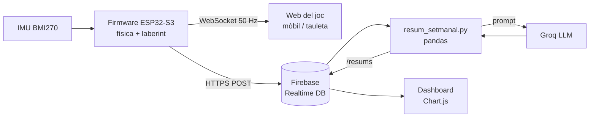

# Laberint AtomS3R per a gent gran

Joc IoT de laberint que es controla **inclinant un M5Stack AtomS3R (ESP32-S3)**. Pensat per estimular la coordinació ull-mà, l'atenció i la mobilitat del canell de la gent gran d'una manera lúdica, i perquè la família o el fisioterapeuta en puguin seguir l'evolució.

> Eina de motivació i seguiment. **No és un aparell mèdic.**

## Què fa

- **Física real de la bola:** l'IMU es llegeix a 50 Hz i la inclinació es converteix en acceleració, amb fregament, rebots i col·lisions amb les parets.
- **Un laberint nou a cada partida:** generació procedural amb *recursive backtracker*, obertura de camins alternatius i validació amb **BFS** que sempre hi ha camí fins a la meta tot i els forats.
- **El joc en gran, sense ordinador:** el mateix ESP32 serveix una pàgina web i envia la posició de la bola per **WebSocket** 50 cops per segon. S'obre des de qualsevol mòbil, tauleta o TV de la mateixa xarxa.
- **Dades al núvol:** cada partida (temps, caigudes, si ha arribat a la meta) s'envia a **Firebase Realtime Database** per WiFi.
- **Resum setmanal amb IA:** un script de Python (pandas) compara la setmana amb l'anterior i un **LLM (Groq)** redacta un resum entenedor per a la família.
- **Dashboard:** indicadors clau, objectius setmanals configurables i evolució del temps i les caigudes (Chart.js).

## Arquitectura



## Tecnologies

| Part | Tecnologia |
|---|---|
| Maquinari | M5Stack AtomS3R (ESP32-S3, IMU BMI270, pantalla 128×128) |
| Firmware | C++ / Arduino, M5Unified, WebServer, WebSockets (Markus Sattler), HTTPClient |
| Núvol | Firebase Realtime Database (API REST) |
| Anàlisi i IA | Python, pandas, requests, Groq (LLM) |
| Visualització | HTML, CSS, JavaScript, Canvas, Chart.js |

## Estructura

```
laberint/
  laberint.ino          firmware: joc, física, generador, web + WebSocket, Firebase
  secrets.example.h     plantilla de credencials (copia-la com a secrets.h)
dashboard/
  dashboard.html        dashboard d'evolució i objectius
  resum_setmanal.py     estadístiques setmanals + resum amb IA
```

## Posar-ho en marxa

**Firmware**
1. Arduino IDE amb la placa M5Stack (ESP32) i les llibreries **M5Unified** i **WebSockets** (Markus Sattler).
2. Copia `laberint/secrets.example.h` com a `laberint/secrets.h` i omple el WiFi (2,4 GHz) i la URL de Firebase.
3. Puja `laberint.ino`. A la pantalla de l'Atom surt l'adreça IP: obre-la des d'un dispositiu de la mateixa xarxa (o `http://entrenador.local`).

**Firebase**
Crea una Realtime Database. Les partides es guarden a `/sessions` i els resums a `/resums`.

**Resum amb IA**
```
pip install requests pandas
$env:FIREBASE_URL="https://...firebasedatabase.app"
$env:GROQ_API_KEY="gsk_..."
python dashboard/resum_setmanal.py
```

**Dashboard**
Posa la URL de Firebase a `FIREBASE_URL` al principi de `dashboard.html` i obre'l al navegador.

## Proves amb usuaris

Proves informals amb 2 persones de 65 a 68 anys.

## Límits i properes passes

- Prototip: la base de dades està en mode de prova. Per a ús real caldria autenticació i regles de seguretat a Firebase.
- Nivells de dificultat (mida del laberint, nombre de forats) que s'adaptin automàticament als resultats.
- Diferents perfils d'usuari al mateix dispositiu.
